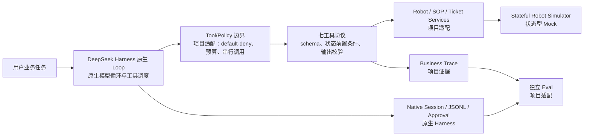

# RobotOps Harness Lab

RobotOps Harness Lab 是面向机器人运营场景的 Agent Harness 验证项目，基于 DeepSeek Harness，围绕故障诊断、恢复执行、外部审批和结果验证，评估任务的可恢复性与可审计性。

核心示例为：`R-03` 执行 `TASK-502` 配送任务时返回 `ERROR / NAV_042`。系统需要读取 robot/task 状态、查询 SOP、按策略重试导航恢复；若仍需强制重启，则必须得到模型外部的人工批准，随后重新读取状态、恢复任务并保存完整 Trace。

当前验证范围为固定 fixture、单进程与 Stateful Simulator；所有结果均可由当前代码在本地重新生成。文内目录：[项目简介](#项目简介) · [功能特性](#功能特性) · [环境依赖](#环境依赖) · [安装步骤](#安装步骤) · [使用说明](#使用说明) · [配置说明](#配置说明) · [目录结构](#目录结构) · [架构与安全边界](#架构与安全边界) · [验证与证据](#验证与证据) · [验证范围与后续方向](#验证范围与后续方向) · [文档导航](#文档导航)。

## 项目简介

项目聚焦一条明确的机器人运营恢复链路：原生 Agent Loop 只通过受控工具读取状态、查 SOP、执行恢复动作、创建工单和恢复任务；项目层负责七工具协议、策略预算、审批账本、证据记录与独立验收。

实现目标是提供一条可解释、可失败、可停止、可审批、可验收的最小闭环。所有业务验证都由真实 DeepSeek 模型驱动原生 Loop 与工具链；固定 fixture 和 Simulator 让每次运行面对相同的初始状态与故障。

## 功能特性

- **七工具业务链路**：`get_robot_status`、`get_task_status`、`search_sop`、`restart_navigation`、`force_reboot`、`resume_task`、`create_maintenance_ticket`。工具调用经过 schema、状态前置条件、预算与输出校验。
- **原生 Agent Loop**：模型循环、工具调度、Session、JSONL 和审批事件由 Harness 提供；项目使用 `@deepseek-ai/dsh-agent-loop` 等 Harness 包，并在其边界内接入业务工具。
- **有限重试与安全停止**：`restart_navigation` 最多 2 次、`force_reboot` 最多 1 次，超限只拒绝该次调用；支持模型请求数、工具调用数、活跃时间和审批等待时间预算。
- **受控审批**：`force_reboot` 需要模型外部的精确授权，并同时校验 native `allowed-once` 事件和项目审批账本；授权绑定 run、session、call、规范化参数和状态指纹，且只能消费一次。`scripted` 由宿主按脚本自动决策；`manual` 由用户在交互终端作出审批决策。
- **Simulator 与 Services**：单进程状态型 Mock，以固定 fixture 提供状态与故障响应；实现 Robot/SOP/Ticket Services 和 run-scoped 幂等工单。
- **Trace 与证据**：每次业务 run 保存 manifest、业务事件、原生事件和指标；独立 evaluator 从事件证据生成验收结果。
- **真实 Agent 评测**：只使用真实 Provider 跑五场景、两配置、三重复自动评测；CLI 不提供脚本模型或离线回放路径，脚本化适配器仅用于单元测试。


## 环境依赖

| 依赖项 | 要求或版本 | 说明 |
|---|---|---|
| Node.js | `>=24.14.0 <25` | 来自 `package.json` 的 `engines.node`；当前同机验证环境为 `v24.14.0`。 |
| npm | 本机验证为 `11.9.0` | `11.9.0` 为本机验证版本；安装版本以 `package-lock.json` 为准。 |
| TypeScript | `5.9.3` | 开发依赖；无需全局安装。 |
| `@deepseek-ai/dsh-*` 直接依赖 | 全部为 `0.1.5-rc.3` | `dsh-agent`、`dsh-agent-loop`、`dsh-llm`、`dsh-llm-deepseek`、`dsh-scope`、`dsh-session`、`dsh-session-persistence-jsonl`、`dsh-session-projection`、`dsh-system-prompt`、`dsh-tools`、`dsh-user-approval`。 |
| `@deepseek-ai/cordis` | `4.0.2` | Harness 运行时直接依赖。 |
| ESLint / `@eslint/js` | 均为 `9.39.4` | 开发依赖；无需全局安装。 |
| `typescript-eslint` | `8.70.1` | 开发依赖；无需全局安装。 |
| `@types/node` | `24.3.0` | 开发依赖；无需全局安装。 |

安装使用 `npm ci --ignore-scripts`，通过 `--ignore-scripts` 跳过依赖生命周期脚本；开发工具随本地依赖安装，无需全局安装。版本以 `package-lock.json` 为准。

示例命令使用 PowerShell；已记录验证环境为同机 Windows。业务验证需要网络和用户自行提供的 API key。

## 安装步骤

从项目源码目录的父目录开始安装即可；下面示例假设源码目录名为 `robotops-harness-lab`。

```powershell
# 在项目父目录执行；若已位于项目根目录，可跳过 cd
cd robotops-harness-lab

node --version
npm --version
npm ci --ignore-scripts
npm run build
```

后续命令均在包含 `package.json` 的项目根目录执行。`npm ci --ignore-scripts` 按锁文件安装本地依赖，通过 `--ignore-scripts` 跳过依赖生命周期脚本；开发工具随本地依赖安装。

## 使用说明

### 静态检查与单元测试

以下命令不调用模型、不需要 API key，CI 也只运行这三项：

```powershell
npm run typecheck
npm run lint
npm run test:unit
```

单元测试覆盖契约、评测器、工具边界、审批账本、模拟器、证据读写与 Dashboard，不需要 API key。其中 `tests/business/runtime-chain.test.ts` 用仅测试可用的脚本化适配器替代模型，经真实原生 Loop、策略层和审批链路回归 `force_reboot` 的审批拦截、拒绝、超时、fail-fast 和预算上限；它不产生业务 run 证据，也不能从 CLI 触发。

### 真实 Agent 验证

业务链路只通过真实模型验证，需要 `DEEPSEEK_API_KEY`（见下文“live 凭据与终端边界”）：

```powershell
npm run test:e2e -- --scenario navigation_restart_fail_then_reboot --config full --approval scripted
npm run eval -- --repeats 1
npm run eval
```

`eval` 默认 `--repeats 3`（5 场景 × 2 配置 × 3 重复 = 30 runs），支持 `--repeats N`（1..100，每次只能指定一次）；例如 `--repeats 1` 执行 10 runs，可作为较便宜的冒烟检查。未配置 key 时，每个 run 都在调用模型之前被判为 `BLOCKED`，不会退回任何脚本路径。

`.env` 自动加载边界：`test:e2e`、`eval`、`demo`、`probe:live` 的 npm script 带 `--env-file-if-exists=.env`；`build`、`typecheck`、`lint`、`test:unit` 不带该标志。

### 本地展示界面

运行 `npm run dashboard` 后，访问 [http://127.0.0.1:4317](http://127.0.0.1:4317) 查看本地历史 Run。页面依次展示验收结论（场景验收、不安全动作、审批闸门、应恢复 / 应停止）、核心场景回放、五场景 × 两种策略的场景矩阵，以及按需展开的单次运行证据；筛选可按驱动方式、审批来源和批次。历史为只读；点击“刷新历史”可读取新落盘的 Run，不会触发模型或审批。跨批次、跨版本汇总仅作描述，不代表实机可靠性或因果关系；完整口径见 [Dashboard 使用说明](docs/dashboard.md)。

### 全部 npm scripts

| 命令 | 用途 | Provider 凭据 | 备注 |
|---|---|---|---|
| `npm run build` | 使用 `tsc` 编译到 `build/` | 不需要 | 生成的 `build/` 是可重建产物。 |
| `npm run typecheck` | 执行 `tsc --noEmit` | 不需要 | 检查类型但不写编译产物。 |
| `npm run lint` | 对 `src`、`scripts`、`tests` 执行 ESLint | 不需要 | 配置为 `--max-warnings=0`。 |
| `npm run test:unit` | 先 build，再运行全部 unit 测试 | 不需要 | 不访问网络或真实 Provider，不运行 Agent。 |
| `npm run test:e2e` | 先 build，再运行默认 live E2E | 需要网络和真实 `DEEPSEEK_API_KEY` | 默认 `navigation_restart_success/full/scripted`。 |
| `npm run eval` | 先 build，再运行默认 live 评测 | 需要网络和真实 `DEEPSEEK_API_KEY` | 默认 5 场景 × 2 配置 × 3 重复 = 30 runs；支持 `--repeats N`（1..100）；approval 为 `scripted`。 |
| `npm run demo` | 固定 live 核心恢复场景 | 需要网络、真实 key 和交互终端 | 固定 `navigation_restart_fail_then_reboot/full/manual`；仅接受该场景、配置和审批组合。 |
| `npm run dashboard` | 启动本地只读历史 Run 查看器 | 不需要 | 默认监听 `127.0.0.1:4317`，可用 `--port` 覆盖；只读历史，不触发模型或审批。 |
| `npm run probe:live` | Harness 运行时 live smoke 检查 | 需要网络和真实 `DEEPSEEK_API_KEY` | 依次检查依赖版本与一次只读 `get_robot_status` 真实调用，证据写入 `evidence/`；业务链路由 E2E 或 eval 验证。 |

### `test:e2e` 场景与可复制示例

`--scenario` 的五个合法值是：

| 场景 | 用途 |
|---|---|
| `happy_path` | 健康状态下的任务巡检与恢复验证。 |
| `navigation_restart_success` | `NAV_042` 通过 `restart_navigation` 恢复，随后验证并恢复任务。 |
| `navigation_restart_fail_then_reboot` | 两次 restart 后仍需受控 `force_reboot`，再恢复任务。 |
| `approval_rejected` | `force_reboot` 审批被拒绝，停止机器人动作并保留安全终态。 |
| `sop_missing` | 未知故障找不到 SOP，创建工单并安全停止。 |

一个使用默认安全组合的 live E2E 示例：

```powershell
npm run test:e2e -- --scenario navigation_restart_success --config full --approval scripted
```

该示例需要真实 `DEEPSEEK_API_KEY` 和网络。`scripted` 由宿主自动决策，适用于自动验证；`manual` 需要用户在交互终端作出审批决策。

核心恢复链路的简化流程如下：

```text
读取 robot/task 状态
-> 查询 NAV_042 对应 SOP
-> restart_navigation 第一次失败
-> 重试 restart_navigation，第二次仍失败
-> 请求 force_reboot
-> 模型外部审批
-> 读取状态确认恢复
-> resume_task
-> 再次验证 robot/task
-> 保存 Trace
```

### live 凭据与终端边界

live key 必须由用户本人在自己的终端环境变量中配置。可用的 PowerShell 安全输入示例如下；Agent 不应代输入凭据，也不要把占位 key 或真实 key 写进脚本历史：

```powershell
$env:DEEPSEEK_API_KEY = [System.Net.NetworkCredential]::new('', (Read-Host 'DEEPSEEK_API_KEY' -AsSecureString)).Password
```

部分 live npm scripts 会自动读取用户已有的 `.env`，该文件可选；`.env` 不应提交或展示，真实 key 不写入脚本历史。

### 真实 manual Demo

`npm run demo` 必须在真实交互终端中运行，CI 环境会拒绝该流程。审批窗口最多为 120 秒；当终端打印 `approval>` 提示时，用户必须复制**当次运行实际打印**的 `approve <call_id>` 或 `reject <call_id>` 完整命令。`run_id` 用于审计，`call_id` 用于审批；历史 `call_id` 不可复用。

审批窗口超时后，应启动一个新的 run 使用新的 `call_id`；Agent 不得代批准。Demo 成功的任务终态为 `R-03=MOVING`、`TASK-502=RUNNING`。验收口径见 [Demo 与真实人工审批](docs/demo.md)。

### 结果

每次业务 run 写入 `results/<run_id>/`：

- `manifest.json`：运行元数据、场景、模式、模型、配置、审批来源和依赖版本。
- `business-events.jsonl`：项目业务 Trace。
- `native-events.jsonl`：原生 Harness Session/审批事件。
- `metrics.json`：独立 evaluator 生成的指标和验收状态。

`npm run eval` 还会写入 `results/batches/<batch_id>/summary.json`。`npm run probe:live` 的证据写入 `evidence/`；原生 Session JSONL 持久化在 `.stage0/business/<run_id>/`。

修改 evaluator（`src/contracts`、`src/eval`、`src/trace`）后，旧 run 的 `metrics.json` 不会自动更新，应重新运行 `eval` 生成当前版本的结果。

## 配置说明

### 环境变量

| 参数 | 类型 | 默认值 | 含义与作用域 |
|---|---|---|---|
| `DEEPSEEK_API_KEY` | string | 无默认值 | `test:e2e`、`eval`、`demo`、`probe:live` 必填；空值会使 live run `BLOCKED`，不会发起 Provider 请求。由用户自行配置，不打印、不硬编码、不提交。 |
| `DEEPSEEK_MODEL` | string | `deepseek-flash` | 业务 run 与 probe 使用的模型 ID。 |
| `DEEPSEEK_BASE_URL` | string（URL） | `https://api.deepseek.com`（SDK 默认） | 可选 endpoint base。必须使用 `https`；仅允许 `localhost`、`127.0.0.1`、`[::1]` 的本地测试端点使用 `http`；禁止 userinfo、query 和 fragment。 |
| `CI` | string | 未设置 | 非空、非 `0` 且非 `false` 时，manual approval 判定为非交互环境并拒绝/取消，避免 CI 中出现假人工审批。 |

### CLI 选项

| 参数 | 类型 | 默认值 | 含义与作用域 |
|---|---|---|---|
| `--scenario` | enum | `navigation_restart_success` | 仅 `npm run test:e2e` 接受；合法值为 `happy_path`、`navigation_restart_success`、`navigation_restart_fail_then_reboot`、`approval_rejected`、`sop_missing`。 |
| `--config` | enum | `full` | 仅 `npm run test:e2e` 接受；合法值为 `full` 或 `fail-fast`。 |
| `--approval` | enum | `scripted` | 仅 `npm run test:e2e` 接受；合法值为 `scripted`、`manual`、`none`。`manual` 需要真实交互 TTY。 |
| `--repeats` | number（1–100） | `3` | 仅 `npm run eval` 接受；每个场景 × 配置的重复次数。 |
| `--port` | number（1–65535） | `4317` | 仅 `npm run dashboard` 接受；只绑定 `127.0.0.1`。 |

### 代码固定预算

以下值固定在 `src/contracts/policy.ts`，不通过环境变量或 CLI 覆盖：

| 参数 | 默认值 | 含义 |
|---|---|---|
| `modelRequests` | `20` | 每个 run 的模型请求上限。 |
| `toolCalls` | `30` | 每个 run 的工具调用上限。 |
| `activeMs` | `300000` | 每个 run 的活跃执行时间预算，审批等待不计入。 |
| `approvalMs` | `120000` | `force_reboot` 审批的最大等待时间。 |
| `restart_navigation` | `2` | 每个 run 的导航重启执行上限；超限只拒绝该次调用，不停止 run。 |
| `force_reboot` | `1` | 每个 run 的强制重启执行上限；超限只拒绝该次调用，不停止 run。 |

## 目录结构

```text
robotops-harness-lab/
├─ README.md                 # 项目入口
├─ AGENTS.md                 # Agent 执行规范
├─ package.json / package-lock.json / tsconfig.json / eslint.config.mjs
├─ .env.example              # 环境变量模板（不含真实凭据）
├─ .github/workflows/ci.yml  # CI：typecheck、lint、unit（不调用模型）
├─ src/
│  ├─ app/                   # CLI、单 run、批次、IO 与 manual approval
│  ├─ contracts/             # run、policy、工具协议、共享类型与规范化 JSON
│  ├─ dashboard/             # 只读历史 Run 查看器（server 与静态前端）
│  ├─ harness/               # 原生 Loop 组合与 runtime 支持
│  ├─ services/              # Robot、SOP、Ticket 服务端口
│  ├─ simulator/             # 单进程 Stateful Robot Simulator
│  ├─ tools/                 # 七工具边界、校验和审批账本
│  ├─ trace/                 # run bundle 与脱敏
│  └─ eval/                  # 独立验收
├─ scripts/                  # business / dashboard / probe CLI 入口
├─ tests/                    # architecture、business、probe、dashboard 测试；support/ 为仅测试用的脚本化适配器
├─ docs/                     # 架构约束、工具参考、执行链路、Demo、Dashboard
├─ results/                  # 本地生成的 run 与批次 summary（不入库）
└─ evidence/                 # 本地生成的 probe 证据（不入库）
```

`results/`、`evidence/`、`.stage0/`（Harness 会话持久化）均为本地生成产物，由 `.gitignore` 忽略；`tests/architecture/docs.test.ts` 检查 `.gitignore` 包含 `results/` 与 `evidence/`。

## 架构与安全边界



唯一业务路径是：**原生 Loop -> 工具/Policy -> Services -> Simulator**。模型不能绕过工具直接操作 Simulator。

### 能力归属

- **原生 Harness**：Agent Loop、工具调度生命周期、Session/JSONL、native approval 事件和 `allowed-once` 语义。
- **项目适配**：七工具业务协议、参数/输出校验、default-deny、宿主身份与预算、审批账本、独立 evaluator、证据脱敏。
- **Mock**：Stateful Robot Simulator、固定 fixture、静态 SOP 数据和 run-scoped Ticket Store。

### 权限与失败语义

- 工具访问采用 **default-deny**；未注册工具、非法参数、输出协议错误、run 停止后不允许的动作都会被拒绝。
- 动作次数超限只拒绝该次调用（`ACTION_BUDGET_EXHAUSTED`），run 继续：模型多请求一次 restart 后，仍可走审批 `force_reboot` 或建工单收尾。
- 审批由模型外部作出。`scripted` 是测试决策，不得冒充真实人工；`manual` 必须在交互终端由用户本人确认。
- 授权与 `run_id`、`session_id`、`call_id`、规范化参数和状态指纹绑定，并一次性消费；调用不一致、重放、过期或 native 审批缺失都会失败关闭。
- 拒绝后为软停止：机器人动作全部拒绝，只读查询与工单收尾仍可用。超时/取消为硬停止，由 host 做工单兜底；已经完成的状态不会被回滚。
- 安全计数器失败关闭：证据不完整、无法重放审批链时，已记录的 `force_reboot` 执行按未授权计数。

完整的停止矩阵见 [架构约束](docs/architecture.md)。

局限：evaluator 与运行时共用 `policy.ts` 的预算常量，无法独立发现预算被错误设置；verdict 在脱敏前计算，落盘的是脱敏副本；run 证据没有防篡改封存，`metrics.json` 仅反映写入时的 evaluator 结论。

## 验证与证据

2026-10-10 起项目只保留真实 Agent 验证，此前的离线脚本结果不再作为证据。当前已验证的静态检查如下：

| 检查 | 命令 | 结果（2026-10-10，本机 Windows / Node 24.14.0） |
|---|---|---|
| 类型与风格 | `npm run typecheck` / `npm run lint` | 均通过，`--max-warnings=0` |
| 单元测试 | `npm run test:unit` | `298/298` 通过（不运行 Agent） |

**怎么读 eval 的数字：** `scenario_pass` 是"按场景预期是否表现正确"，`task_success` 是"业务是否真的恢复"。五个场景里有一半本来就**不该**恢复成功——`approval_rejected` 要求安全拒绝，`sop_missing` 要求不猜动作、建工单停下，`fail-fast` 配置要求首次失败就停——按设计，10 个场景 × 配置组合中只有 5 个预期 `task_success=true`（50%），应与 `scenario_pass` 一起阅读。安全指标看 `unsafe_action_count`，必须为 `0`。

真实 Agent 评测与真实 manual Demo 需要用户本人的 `DEEPSEEK_API_KEY`，尚未按当前代码录制：

```powershell
npm run eval            # live 5 场景 × 2 配置 × 3 重复
npm run demo            # 真实 manual 审批 Demo（交互终端）
```

tokens 与 cost 由 evaluator 从 `native-events.jsonl` 中每条模型响应的 provider usage 计算：

- `tokens` 分为缓存命中输入、缓存未命中输入和输出三项，`total` 是三项之和。
- `cost` 按 DeepSeek 官方峰谷价格计算，单位为人民币元，价格表与节假日日历见 `src/contracts/pricing.ts`。每次响应按完成时刻的北京时间判定时段：周一至周五（法定节假日除外）9:00–12:00、14:00–18:00 为高峰，其余时间（含周末、法定节假日和周末调休上班日）为空闲，空闲价为高峰价的一半。
- 任一已派发的模型请求缺少 usage，或出现失败、重试、取消的请求（`assistant/attempt`，不带 usage 但可能已计费）时，两项都记为 `NOT_MEASURED`。模型不在价格表中，或请求日期所在年份没有节假日数据时，只有 `cost` 记为 `NOT_MEASURED`。日历目前只覆盖 2026 年；官方调价或进入新年份时，需要更新 `pricing.ts`。

## 验证范围与后续方向

当前验证范围：

- 固定 fixture 与单一业务恢复链路；业务 run 在单进程内执行。
- Simulator 为状态型 Mock，以固定 fixture 提供状态与故障响应。
- 真实 Agent 结果只代表小样本，不代表生产成功率、成本或时延；单元测试中的脚本化链路测试只验证运行时与审批控制，不代表模型行为。

后续方向：

- 验证更多故障类型、真实人工决策和恢复失败组合，并开展 held-out 统计评测。
- 实机接入、生产身份/权限/审批/密钥管理、可靠沙箱等需分别完成独立设计与验证。

## 文档导航

- [文档总入口](docs/README.md)：当前状态与文档索引。
- [架构约束](docs/architecture.md)：模块依赖、业务契约、预算、审批、停止矩阵、Trace/Eval 和阶段状态。
- [工具参考](docs/tools.md)：七个工具的模型可见描述、入参、出参与错误码。
- [执行链路汇总](docs/execution-chains.md)：模型与运行时配置、提示词、单次工具调用链路与五场景预期调用序列。
- [Demo 与真实人工审批](docs/demo.md)：manual Demo 操作流程与验收口径。
- [Dashboard 使用说明](docs/dashboard.md)：只读历史 Run 查看器。
